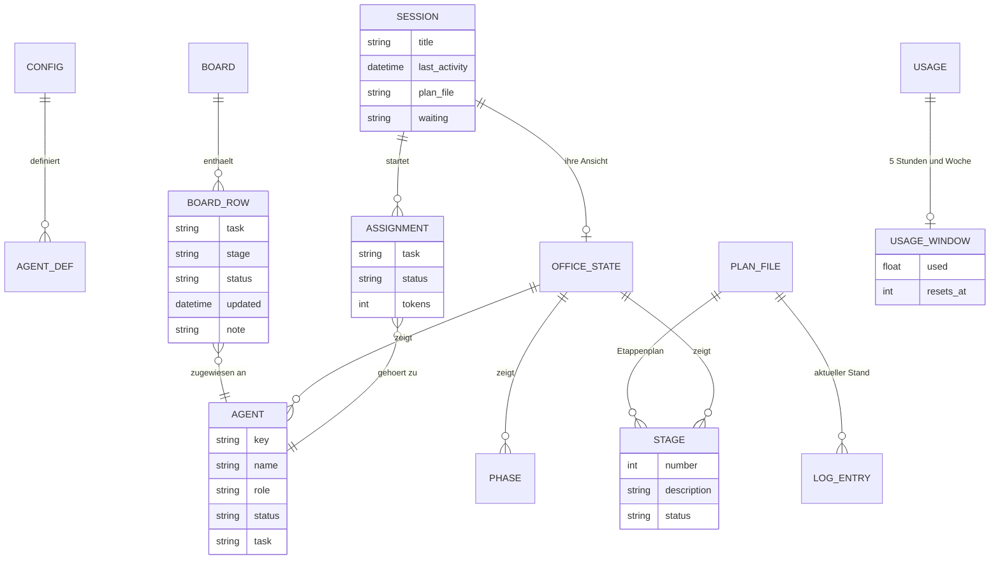
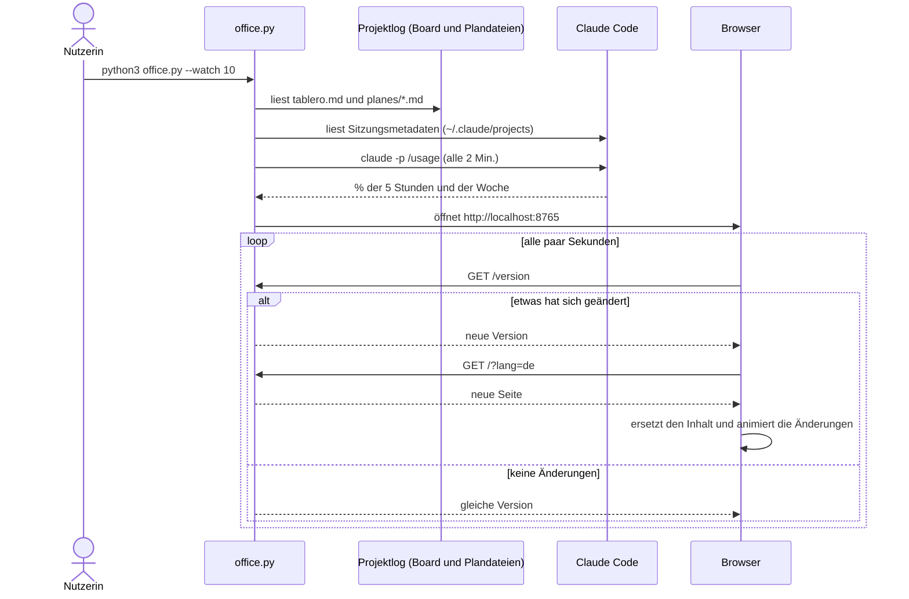
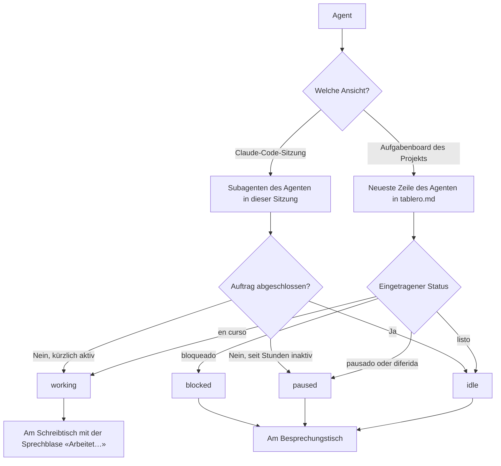

# Agentenbüro

[English](README.md) · [Español](README.es.md) · **Deutsch**

Ein isometrisches Pixel-Art-Büro im Browser, das zeigt, was deine
Claude-Code-Agenten gerade tun, während sie ein Projekt entwickeln: wer
arbeitet, in welcher Etappe der Plan steht, wer auf deine Antwort wartet und
wie viel von deinen Nutzungslimits übrig ist. Verfügbar auf Spanisch, Englisch
und Deutsch. Reines Python ohne Abhängigkeiten; es läuft auf deinem Rechner und
veröffentlicht nichts.

## Was es zeigt

- **Der Raum:** ein Schreibtisch pro Agent. Wer arbeitet, sitzt an seinem
  Schreibtisch, mit eingeschaltetem Bildschirm und einer Sprechblase
  «Arbeitet…». Die anderen sitzen am Besprechungstisch; ändert sich ihr Status,
  gehen sie von einem Platz zum anderen.
- **Die Wände:** die 8 Prozessphasen (Analyse, Design, Umsetzung, Tests,
  Sicherheit, Review, Dokumentation, Übergabe) mit hervorgehobener aktueller
  Phase, und der **Änderungsplan** in Etappen. Ein Klick auf den Plan öffnet
  ihn vollständig.
- **Wartet auf deine Antwort:** eine hüpfende Sprechblase über dem Tisch, wenn
  der Koordinator stillsteht und deine Antwort braucht.
- **Sitzungen:** ein Menü, um zwischen deinen aktiven Claude-Code-Sitzungen zu
  wechseln. Jede Sitzung zeigt ihre eigenen Agenten, ihren Plan und ihre Phasen.
- **Nutzungslimits:** das 5-Stunden-Fenster und das Wochenlimit, jeweils mit
  dem Zeitpunkt des Resets.
- **Agentenkarte:** ein Klick auf einen Agenten zeigt Status, Aufgabe, Zeit,
  Tokens und Verlauf.
- **Sprachen:** Umschalter ES / EN / DE in der oberen Leiste; die Auswahl wird
  gespeichert.
- Heller und dunkler Modus sowie eine Ansicht fürs Handy.

## Wie es funktioniert

`office.py` liest das Projektlog (Aufgabenboard und Plandatei des Moduls), die
Metadaten deiner Claude-Code-Sitzungen und deine Nutzungslimits und erzeugt pro
Sprache eine eigenständige HTML-Seite. Im Live-Modus stellt es die Seite unter
`localhost` bereit und aktualisiert sie ohne Neuladen, sobald sich etwas
ändert.

### Datenmodell



### Ablauf (Live-Modus)



### Ablauf: Status eines Agenten



## Anleitung

### Voraussetzungen

- Python 3.10 oder neuer.
- Für Sitzungen und Nutzungslimits: Claude Code installiert (der Befehl
  `claude` funktioniert im Terminal) und angemeldet. Ohne das funktioniert das
  Büro trotzdem, nur ohne diese beiden Teile.

### Ausprobieren

Im Ordner des Repos:

```bash
python3 office.py --watch 10
```

Es öffnet sich ein Browserfenster unter `http://localhost:8765`. Gibt es daneben
kein Projektlog, werden die Daten aus `example/` verwendet. Mit **Strg+C**
beendest du es.

- `--watch 10`: Live-Modus. Prüft alle 10 Sekunden auf Änderungen und
  aktualisiert die Seite ohne Neuladen (Raum, Seitenleiste und Limitanzeigen).
  Ändern sich der Code, die Konfiguration oder eine Sprachdatei, startet der
  Server von selbst neu und das offene Fenster lädt sich selbst neu.
- Ohne `--watch`: schreibt `office.html` (Standardsprache), `office.en.html`
  und `office.de.html` und öffnet die erste Datei.

Der Server lauscht nur auf deinem Rechner (`127.0.0.1`). Ist der Port belegt,
nutze `--port 8766`.

### Mit deinem Projekt verwenden

Das Büro liest zwei Markdown-Dateien, die normalerweise der koordinierende
Agent während der Arbeit füllt:

```text
bitacora/
├── tablero.md
├── planes/
│   └── <modul>.md
└── oficina/          ← dieses Repo
```

Liegt das Repo wie gezeigt im Ordner des Projektlogs, findet es die Dateien
selbst. Andernfalls gib an, wo sie liegen:

```bash
python3 office.py --watch 10 --board pfad/tablero.md --plans pfad/planes --module mein_modul
```

#### Das Aufgabenboard (`tablero.md`)

Eine Tabelle mit einer Zeile pro Aufgabe. Das Logformat ist spanisch, deshalb
sind Spaltennamen und Status auf Spanisch:

```markdown
| Tarea | Etapa | Agente | Estado | Actualizado | Nota |
|---|---|---|---|---|---|
| mein_modul: Etapa 2 (Monatsbericht) | Implementación | Yunho Developer | en curso | 2026-11-17 09:30 |  |
| mein_modul | Seguridad | Seonghwa Auditor | bloqueado | 2026-11-16 17:00 | noch keine Testdatenbank |
```

- **Tarea** (Aufgabe): beginnt mit dem Modulnamen (`mein_modul` oder
  `mein_modul: …`). Steht dort «Etapa N», zählt sie für Etappe N des Plans.
- **Agente** (Agent): es genügt, wenn der Name des Agenten vorkommt.
- **Estado** (Status): `en curso` = arbeitet, `bloqueado` = blockiert,
  `pausado` oder `diferida` = pausiert, `listo` = ohne Aufgabe.
- **Actualizado** (aktualisiert): pro Agent zählt seine neueste Zeile.
- **Etapa** (Etappe): zeigt, in welcher Prozessphase das Modul steht.
- **Nota** (Notiz): erscheint auf der Agentenkarte.

Alle Wörter, nach denen das Büro im Log sucht, stehen in `office/board.py`.

#### Die Plandatei (`planes/<modul>.md`)

Drei Abschnitte, alle optional:

- `## Dónde quedé` (aktueller Stand): Einträge
  `**JJJJ-MM-TT (Agent) — was erledigt wurde**`, die in den Verlauf jedes
  Agenten einfließen.
- `## Avance por fase` (Fortschritt nach Phase): Tabelle
  `| Fase | Estado | Fecha | Agente |` für die Phasen an der Wand.
- `## Plan por etapas` (Etappenplan): eine Zeile
  `Etapas: 1 Beschreibung; 2 Beschreibung; …`, der Plan an der Wand.

Ein vollständiges Beispiel liegt in `example/`.

### Sprachen

Die Texte der Oberfläche stehen in `i18n/es.json`, `i18n/en.json` und
`i18n/de.json`, mit denselben Schlüsseln. Standardsprache und Sprachliste
werden in `config.json` festgelegt (`language`, `languages`). Für eine neue
Sprache kopierst du eine Datei, übersetzt sie und ergänzt sie in `languages`.
Platzhalter in geschweiften Klammern wie `{n}` oder `{title}` bitte stehen
lassen: dort kommen die Daten hin. Projektdaten (Aufgaben, Notizen,
Sitzungstitel) werden nicht übersetzt.

### Anpassen

- **`config.json`:** Standardmodul, Koordinator, Agenten (Schlüssel, Name,
  Rolle und Zone), Phasen und wie sie im Log erkannt werden, Position von
  Schreibtischen, Tisch und Teppichen im Raum sowie Schwellenwerte (Minuten,
  bis eine Sitzung als aktiv gilt, Prozentwerte für Gelb und Rot bei den
  Limits, wie oft sie abgefragt werden …).
- **Avatare:** lege `avatars/<key>.png` ab (der `key` jedes Agenten). Fehlt
  einer, wird eine vom Skript gezeichnete Pixel-Figur verwendet. Der Ordner
  `avatars/` steht in `.gitignore`, damit deine Bilder nicht hochgeladen werden.

### Optionen

| Option | Zweck |
|---|---|
| `--watch SEKUNDEN` | Live-Modus: lokaler Server, prüft alle paar Sekunden auf Änderungen. |
| `--port N` | Port des Servers (Standard 8765). |
| `--module NAME` | Anzuzeigendes Modul. |
| `--board PFAD` / `--plans PFAD` | Wo Aufgabenboard und Plandateien liegen. |
| `--sessions PFAD` | Ordner der Claude-Code-Sitzungen; `""`, um sie auszulassen. |
| `--avatars PFAD` | Ordner der Avatare; `""` für nur gezeichnete Figuren. |
| `--tokens name=N` | Von Hand eingetragene Tokens für einen Agenten (mehrfach möglich). |
| `--no-usage` | Nutzungslimits nicht abfragen. |
| `--no-open` | Kein Browserfenster öffnen. |
| `--output PFAD` | Wohin die erzeugte Seite geschrieben wird. |

## Aufbau des Codes

```text
office.py                Einstiegspunkt (Kommandozeilenoptionen)
office/
├── config.py            Konfiguration, Pfade und Programmversion
├── models.py            Datenstrukturen (Dataclasses)
├── board.py             liest Aufgabenboard und Plandateien (Logformat)
├── state.py             was das Büro zeigt, und laufende Arbeit einer Sitzung
├── sessions.py          Claude-Code-Sitzungen: nur Metadaten
├── usage.py             Nutzungslimits über /usage
├── i18n.py              übersetzte Texte
├── build.py             liest alles und schreibt eine Seite pro Sprache
├── server.py            Live-Modus
├── render/
│   ├── geometry.py      isometrische Projektion und Formen
│   ├── pixel.py         Pixel-Art: Figuren und Dekoration
│   ├── room.py          der Raum: Wände, Schreibtische, Tisch
│   ├── panel.py         Seitenleiste, Menü, Dialoge, Limitanzeigen
│   ├── labels.py        Datum, Zahlen und Status je Sprache
│   └── page.py          setzt die ganze Seite zusammen
└── static/
    ├── office.css
    └── office.js
i18n/es.json, en.json, de.json
config.json
example/                 Beispiel-Aufgabenboard und -Plandatei
```

**Benennung:** Code auf Englisch. Python folgt PEP 8 (`snake_case` für
Funktionen und Variablen, `UPPER_CASE` für Konstanten, `CapWords` für Klassen)
mit Typangaben; JSON-Schlüssel in `snake_case`; CSS-Klassen in `kebab-case`;
JavaScript in `camelCase`. Der Stil wird mit `black` und `ruff` geprüft
(konfiguriert in `pyproject.toml`).

## Datenschutz

- Aus den Claude-Code-Sitzungen werden nur Metadaten gelesen: Titel, Zeiten,
  Auftrag jedes Subagenten, ob er fertig ist, welches Werkzeug er genutzt hat
  und die Tokens. Nie der Text der Gespräche.
- Die Nutzungslimits werden mit dem Claude-Code-Befehl `/usage` abgefragt, der
  keine Tokens verbraucht und keine Sitzung speichert. Das Ergebnis liegt in
  `usage.json`, das nicht ins Repo hochgeladen wird.
- Die erzeugten Seiten (`office*.html`) enthalten deine Projektdaten: sie
  werden ebenfalls nicht hochgeladen.

## Lizenz

MIT. Siehe `LICENSE`.
