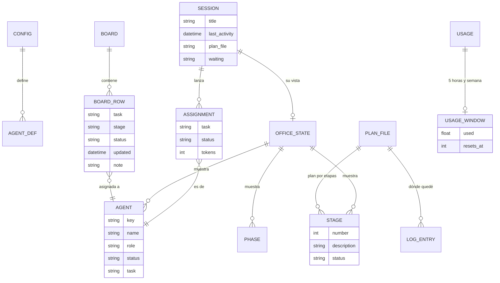
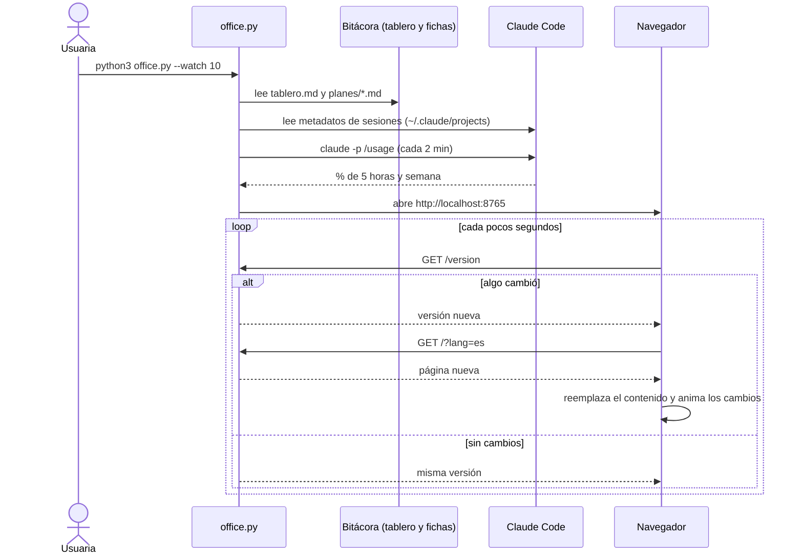
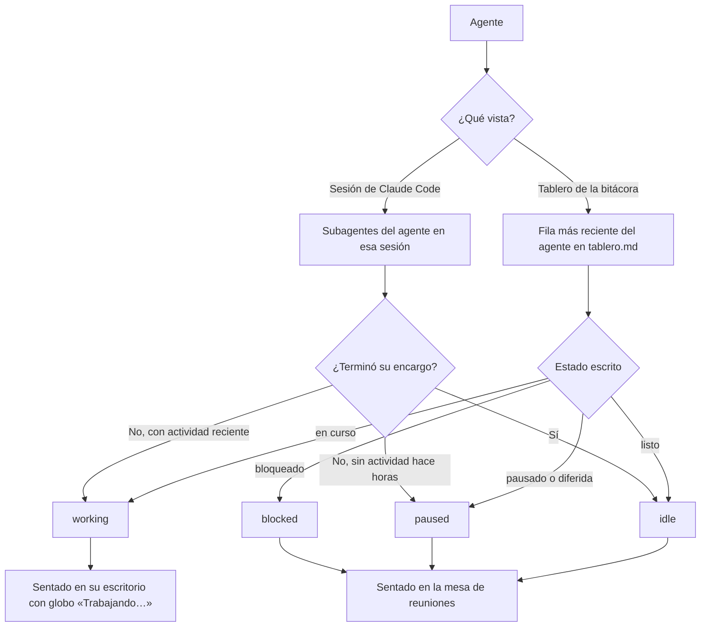

# Oficina de agentes

[English](README.md) · **Español** · [Deutsch](README.de.md)

Una oficina isométrica de pixel art, en el navegador, para ver qué hacen los
agentes de Claude Code mientras desarrollan un proyecto: quién está trabajando,
en qué etapa va el plan, quién espera tu respuesta y cuánto te queda de tus
límites de uso. Disponible en español, inglés y alemán. Es Python puro, sin
dependencias; corre en tu computadora y no publica nada.

## Qué muestra

- **La sala:** un escritorio por agente. Quien está trabajando aparece sentado en
  su escritorio, con la pantalla encendida y un globo «Trabajando…». Los demás
  se sientan en la mesa de reuniones; al cambiar de estado, caminan de un lugar
  al otro.
- **Las paredes:** las 8 fases del proceso (Análisis, Diseño, Implementación,
  Pruebas, Seguridad, Revisión, Documentación, Entrega), con la fase actual
  resaltada, y el **plan del cambio** por etapas. Un clic en el plan lo abre
  completo.
- **Esperando tu respuesta:** un globo que rebota sobre la mesa cuando el
  coordinador está parado esperando que le contestes.
- **Sesiones:** un menú para elegir entre las sesiones activas de Claude Code.
  Cada sesión muestra sus propios agentes, su plan y sus fases.
- **Límites de uso:** la ventana de 5 horas y la semanal, con la hora en que se
  reinicia cada una.
- **Ficha de cada agente:** al hacer clic, su estado, tarea, tiempo, tokens e
  historial.
- **Idiomas:** selector ES / EN / DE en la barra; se recuerda entre visitas.
- Modo claro y nocturno, y vista para celular.

## Cómo funciona

`office.py` lee la bitácora del proyecto (tablero y ficha del módulo), los
metadatos de las sesiones de Claude Code y los límites de uso, y arma una página
HTML autocontenida por idioma. En modo en vivo la sirve en `localhost` y la
actualiza sin recargar cuando algo cambia.

### Modelo de datos



### Secuencia (modo en vivo)



### Flujo: estado de un agente



## Manual de uso

### Requisitos

- Python 3.10 o más nuevo.
- Para las sesiones y los límites: Claude Code instalado (el comando `claude`
  funciona en la terminal) y con tu cuenta iniciada. Sin eso, la oficina
  funciona igual, solo que sin esas dos partes.

### Probarla

Desde la carpeta del repo:

```bash
python3 office.py --watch 10
```

Se abre una ventana del navegador en `http://localhost:8765`. Si no hay una
bitácora al lado, usa los datos de la carpeta `example/`. Para apagarla,
presiona **Ctrl+C**.

- `--watch 10`: modo en vivo. Revisa cambios cada 10 segundos y actualiza la
  página sin recargarla (sala, panel y medidores de límites). Si cambia el
  código, la configuración o un idioma, el servidor se reinicia solo y la
  ventana abierta se recarga sola.
- Sin `--watch`: genera `office.html` (idioma por defecto), `office.en.html` y
  `office.de.html`, y abre el primero.

El servidor escucha solo en tu computadora (`127.0.0.1`). Si el puerto está
ocupado, usa `--port 8766`.

### Usarla con tu proyecto

La oficina lee dos archivos Markdown, que normalmente llena el agente
coordinador mientras trabaja:

```text
bitacora/
├── tablero.md
├── planes/
│   └── <modulo>.md
└── oficina/          ← este repo
```

Si pones el repo dentro de la carpeta de la bitácora como en el dibujo, los
encuentra solo. Si no, indícale dónde están:

```bash
python3 office.py --watch 10 --board ruta/tablero.md --plans ruta/planes --module mi_modulo
```

#### El tablero (`tablero.md`)

Una tabla con una fila por tarea:

```markdown
| Tarea | Etapa | Agente | Estado | Actualizado | Nota |
|---|---|---|---|---|---|
| mi_modulo: Etapa 2 (reporte mensual) | Implementación | Yunho Developer | en curso | 2026-11-17 09:30 |  |
| mi_modulo | Seguridad | Seonghwa Auditor | bloqueado | 2026-11-16 17:00 | falta una base de pruebas |
```

- **Tarea:** empieza con el nombre del módulo (`mi_modulo` o `mi_modulo: …`).
  Si dice «Etapa N», cuenta para la etapa N del plan.
- **Agente:** basta con que contenga el nombre del agente.
- **Estado:** `en curso` = trabajando, `bloqueado` = bloqueado,
  `pausado` o `diferida` = en pausa, `listo` = sin tarea.
- **Actualizado:** para cada agente vale su fila más reciente.
- **Etapa:** marca en qué fase del proceso va el módulo.
- **Nota:** aparece en la ficha del agente.

La bitácora se escribe en español; las palabras que la oficina busca en ella
están todas en `office/board.py`.

#### La ficha del módulo (`planes/<modulo>.md`)

Tres secciones, todas opcionales:

- `## Dónde quedé`: entradas `**AAAA-MM-DD (Agente) — qué hizo**`, que se suman
  al historial de cada agente.
- `## Avance por fase`: tabla `| Fase | Estado | Fecha | Agente |` para las
  fases de la pared.
- `## Plan por etapas`: una línea `Etapas: 1 descripción; 2 descripción; …`,
  que es el plan que se ve en la pared.

Hay un ejemplo completo en `example/`.

### Idiomas

Los textos de la interfaz están en `i18n/es.json`, `i18n/en.json` y
`i18n/de.json`, con las mismas claves. El idioma por defecto y la lista de
idiomas se eligen en `config.json` (`language`, `languages`). Para agregar uno,
copia un archivo, tradúcelo y súmalo a `languages`. Respeta las marcas entre
llaves, como `{n}` o `{title}`: ahí va el dato. Los datos del proyecto (tareas,
notas, títulos de sesiones) no se traducen.

### Personalizar

- **`config.json`:** módulo por defecto, coordinador, agentes (clave, nombre,
  rol y zona), fases y cómo reconocerlas en la bitácora, ubicación de
  escritorios, mesa y alfombras en la sala, y umbrales (minutos para que una
  sesión cuente como activa, porcentajes de ámbar y rojo de los límites, cada
  cuánto se consultan…).
- **Avatares:** pon `avatars/<clave>.png` (la `key` de cada agente). Si falta
  alguno, se usa un personaje de pixel art dibujado por el script. La carpeta
  `avatars/` está en `.gitignore` para que tus imágenes no se suban.

### Opciones

| Opción | Para qué |
|---|---|
| `--watch SEGUNDOS` | Modo en vivo: servidor local y revisión de cambios cada tantos segundos. |
| `--port N` | Puerto del servidor (por defecto 8765). |
| `--module NOMBRE` | Módulo a mostrar. |
| `--board RUTA` / `--plans RUTA` | Dónde están el tablero y las fichas. |
| `--sessions RUTA` | Carpeta de sesiones de Claude Code; `""` para no usarlas. |
| `--avatars RUTA` | Carpeta de avatares; `""` para usar solo los dibujados. |
| `--tokens nombre=N` | Tokens anotados a mano para un agente (se puede repetir). |
| `--no-usage` | No consultar los límites de uso. |
| `--no-open` | No abrir la ventana del navegador. |
| `--output RUTA` | Dónde escribir la página generada. |

## Estructura del código

```text
office.py                punto de entrada (opciones de la línea de comandos)
office/
├── config.py            configuración, rutas y versión del programa
├── models.py            estructuras de datos (dataclasses)
├── board.py             lectura del tablero y las fichas (formato de la bitácora)
├── state.py             qué muestra la oficina, y el trabajo en vivo de una sesión
├── sessions.py          sesiones de Claude Code: solo metadatos
├── usage.py             límites de uso con /usage
├── i18n.py              textos traducidos
├── build.py             lee todo y escribe una página por idioma
├── server.py            modo en vivo
├── render/
│   ├── geometry.py      proyección isométrica y formas
│   ├── pixel.py         pixel art: personajes y adornos
│   ├── room.py          la sala: paredes, escritorios, mesa
│   ├── panel.py         panel lateral, menú, modales, límites
│   ├── labels.py        fechas, números y estados según el idioma
│   └── page.py          arma la página completa
└── static/
    ├── office.css
    └── office.js
i18n/es.json, en.json, de.json
config.json
example/                 tablero y ficha de ejemplo
```

**Nomenclatura:** código en inglés. Python sigue PEP 8 (`snake_case` para
funciones y variables, `UPPER_CASE` para constantes, `CapWords` para clases) con
tipos anotados; claves JSON en `snake_case`; clases CSS en `kebab-case`;
JavaScript en `camelCase`. El estilo se revisa con `black` y `ruff`
(configurados en `pyproject.toml`).

## Privacidad

- De las sesiones de Claude Code solo se leen metadatos: título, horas, encargo
  de cada subagente, si terminó, qué herramienta usó y los tokens. Nunca el
  texto de las conversaciones.
- Los límites se consultan con el comando `/usage` de Claude Code, que no
  consume tokens ni guarda una sesión. El resultado queda en `usage.json`, que
  no se sube al repo.
- Las páginas generadas (`office*.html`) llevan los datos de tu proyecto:
  tampoco se suben.

## Licencia

MIT. Ver `LICENSE`.
