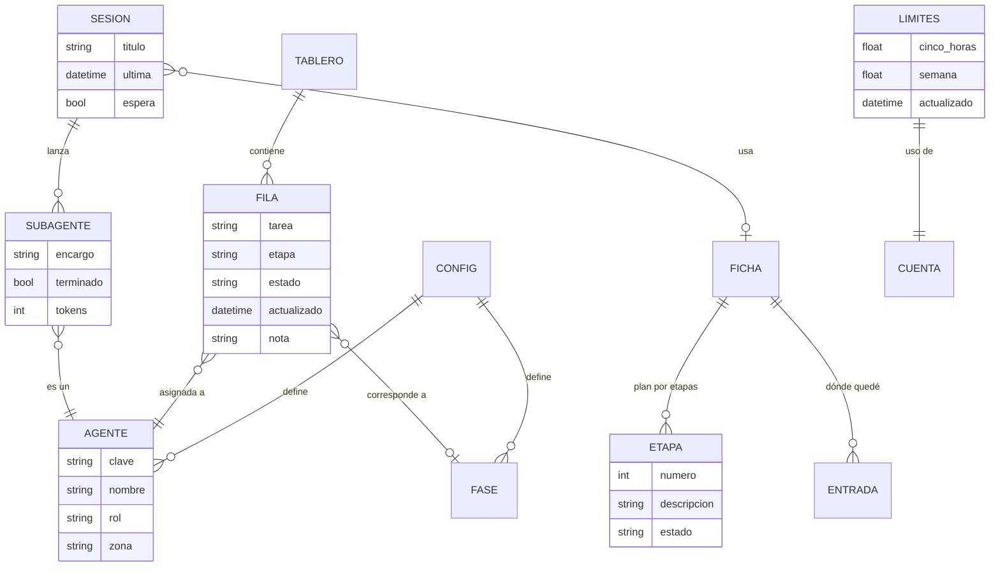
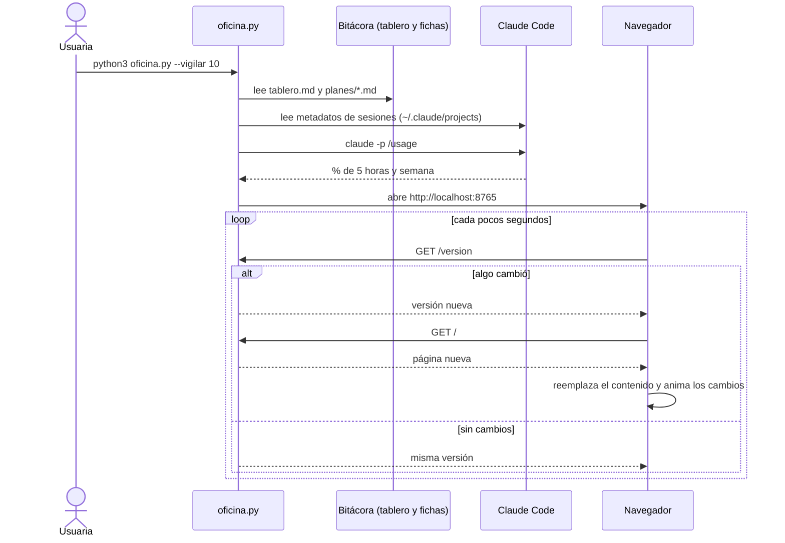
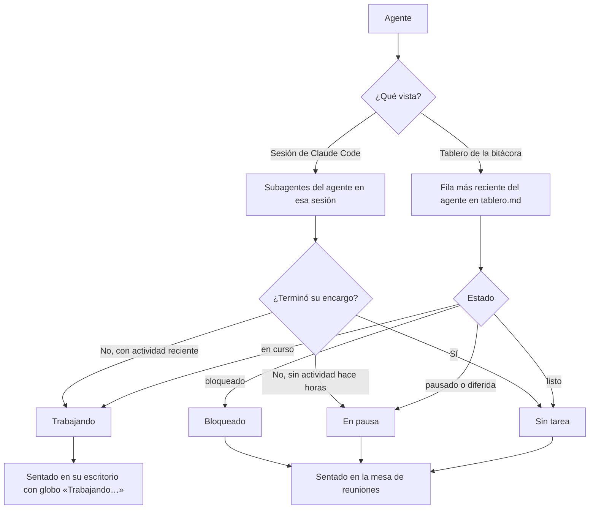

# Oficina de agentes

Una oficina isométrica de pixel art, en el navegador, para ver qué hacen los
agentes de Claude Code mientras desarrollan un proyecto: quién está trabajando,
en qué etapa va el plan, quién espera tu respuesta y cuánto te queda de tus
límites de uso. Es un solo script de Python, sin dependencias, que corre en tu
computadora y no publica nada.

## Qué muestra

- **La sala:** un escritorio por agente. Quien está trabajando aparece sentado en
  su escritorio, con la pantalla encendida y un globo «Trabajando…». Los demás
  se sientan en la mesa de reuniones.
- **Las paredes:** las 8 fases del proceso (Análisis, Diseño, Implementación,
  Pruebas, Seguridad, Revisión, Documentación, Entrega), con la fase actual
  resaltada, y el **plan del cambio** por etapas. Un clic en el plan lo abre
  completo.
- **Esperando tu respuesta:** un globo que rebota sobre la mesa cuando el
  coordinador está parado esperando que le contestes.
- **Sesiones:** un menú para elegir entre las sesiones activas de Claude Code.
  Cada sesión muestra sus propios agentes, su plan y sus fases.
- **Límites de uso:** la ventana de 5 horas y la semanal, con la hora en que se
  reinicia cada una.
- **Ficha de cada agente:** al hacer clic, su estado, tarea, tiempo, tokens e
  historial.
- Modo claro y nocturno, y vista para celular.

## Cómo funciona

`oficina.py` lee la bitácora del proyecto (tablero y ficha del módulo), los
metadatos de las sesiones de Claude Code y los límites de uso, y arma una sola
página HTML. En modo en vivo la sirve en `localhost` y la actualiza sin
recargar cuando algo cambia.

### Modelo de datos



### Secuencia (modo en vivo)



### Flujo: estado de un agente



## Manual de uso

### Requisitos

- Python 3.9 o más nuevo.
- Para las sesiones y los límites: Claude Code instalado (el comando `claude`
  funciona en la terminal) y con tu cuenta iniciada. Sin eso, la oficina
  funciona igual, solo que sin esas dos partes.

### Probarla

Desde la carpeta del repo:

```bash
python3 oficina.py --vigilar 10
```

Se abre una ventana del navegador en `http://localhost:8765`. Si no hay una
bitácora al lado, usa los datos de la carpeta `ejemplo/`. Para apagarla,
presiona **Ctrl+C**.

- `--vigilar 10`: modo en vivo. Revisa cambios cada 10 segundos y actualiza la
  página sin recargarla. Si cambias el código, `config.json` o `textos.json`,
  se reinicia solo.
- Sin `--vigilar`: genera `oficina.html` una vez y lo abre.

El servidor escucha solo en tu computadora (`127.0.0.1`). Si el puerto está
ocupado, usa `--puerto 8766`.

### Usarla con tu proyecto

La oficina lee dos archivos Markdown, que normalmente llena el agente
coordinador mientras trabaja:

```
bitacora/
├── tablero.md
├── planes/
│   └── <modulo>.md
└── oficina/          ← este repo
```

Si pones el repo dentro de `bitacora/` como en el dibujo, los encuentra solo.
Si no, indícale dónde están:

```bash
python3 oficina.py --vigilar 10 --tablero ruta/tablero.md --planes ruta/planes --modulo mi_modulo
```

#### El tablero (`tablero.md`)

Una tabla con una fila por tarea:

```markdown
| Tarea | Etapa | Agente | Estado | Actualizado | Nota |
|---|---|---|---|---|---|
| mi_modulo: Etapa 2 (reporte mensual) | Implementación | Yunho Developer | en curso | 2026-11-17 09:30 |  |
| mi_modulo | Seguridad | Seonghwa Auditor | bloqueado | 2026-11-16 17:00 | falta una base de pruebas |
```

- **Tarea:** empieza con el nombre del módulo (`mi_modulo` o `mi_modulo: …`).
  Si dice «Etapa N», cuenta para la etapa N del plan.
- **Agente:** basta con que contenga el nombre del agente.
- **Estado:** `en curso` = Trabajando, `bloqueado` = Bloqueado,
  `pausado` o `diferida` = En pausa, `listo` = Sin tarea.
- **Actualizado:** para cada agente vale su fila más reciente.
- **Etapa:** marca en qué fase del proceso va el módulo.
- **Nota:** aparece en la ficha del agente.

#### La ficha del módulo (`planes/<modulo>.md`)

Tres secciones, todas opcionales:

- `## Dónde quedé`: entradas `**AAAA-MM-DD (Agente) — qué hizo**`, que se suman
  al historial de cada agente.
- `## Avance por fase`: tabla `| Fase | Estado | Fecha | Agente |` para las
  fases de la pared.
- `## Plan por etapas`: una línea `Etapas: 1 descripción; 2 descripción; …`,
  que es el plan que se ve en la pared.

Hay un ejemplo completo en `ejemplo/`.

### Personalizar

- **`config.json`:** módulo por defecto, agentes (nombre, rol y zona), zonas,
  fases, ubicación de escritorios y mesa en la sala, umbrales (minutos para que
  una sesión cuente como activa, porcentajes de ámbar y rojo de los límites,
  cada cuánto se consultan…).
- **`textos.json`:** todos los textos que se ven en pantalla. Respeta las marcas
  entre llaves, como `{n}` o `{titulo}`: ahí va el dato.
- **Avatares:** pon `avatares/<clave>.png` (la `clave` de cada agente en
  `config.json`, en minúsculas). Si falta alguno, se usa un personaje de pixel
  art dibujado por el script. La carpeta `avatares/` está en `.gitignore` para
  que tus imágenes no se suban.

### Opciones

| Opción | Para qué |
|---|---|
| `--vigilar SEG` | Modo en vivo: servidor local y revisión de cambios cada SEG segundos. |
| `--puerto N` | Puerto del servidor (por defecto 8765). |
| `--modulo NOMBRE` | Módulo a mostrar. |
| `--tablero RUTA` / `--planes RUTA` | Dónde están el tablero y las fichas. |
| `--sesiones RUTA` | Carpeta de sesiones de Claude Code; `""` para no usarlas. |
| `--avatares RUTA` | Carpeta de avatares; `""` para usar solo los dibujados. |
| `--tokens nombre=N` | Tokens anotados a mano para un agente (se puede repetir). |
| `--sin-limites` | No consultar los límites de uso. |
| `--no-abrir` | No abrir la ventana del navegador. |
| `--salida RUTA` | Dónde escribir la página generada. |

## Privacidad

- De las sesiones de Claude Code solo se leen metadatos: título, horas, encargo
  de cada subagente, si terminó, qué herramienta usó y los tokens. Nunca el
  texto de las conversaciones.
- Los límites se consultan con el comando `/usage` de Claude Code, que no
  consume tokens ni guarda una sesión. El resultado queda en `limites.json`,
  que no se sube al repo.
- `oficina.html` lleva los datos de tu proyecto: tampoco se sube.

## Licencia

MIT. Ver `LICENSE`.
