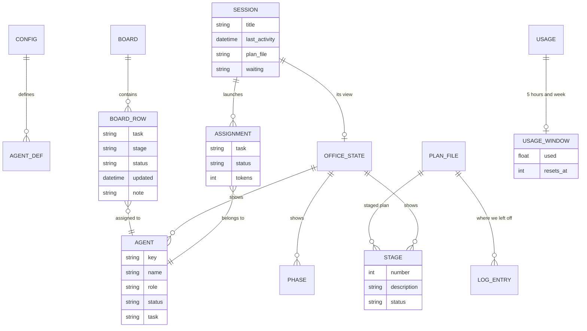
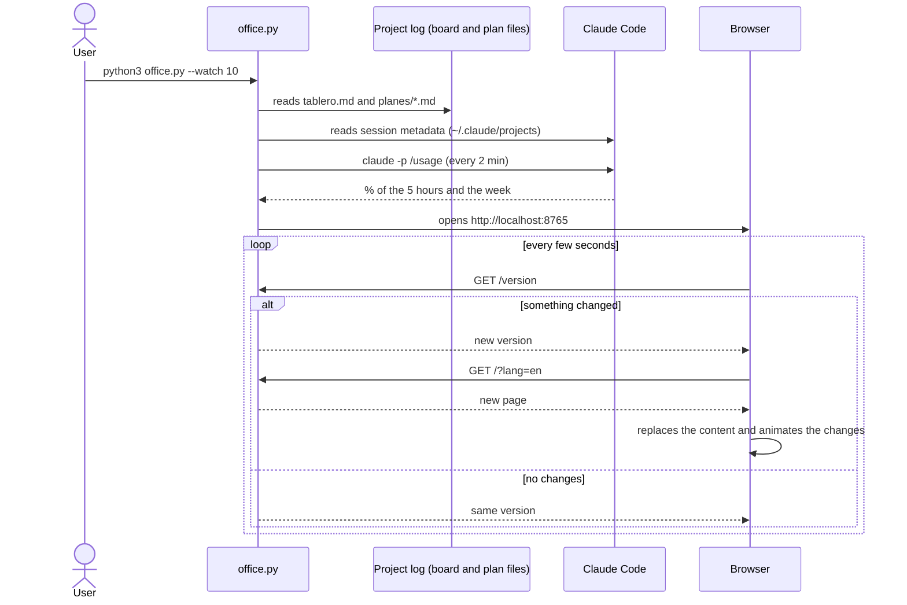
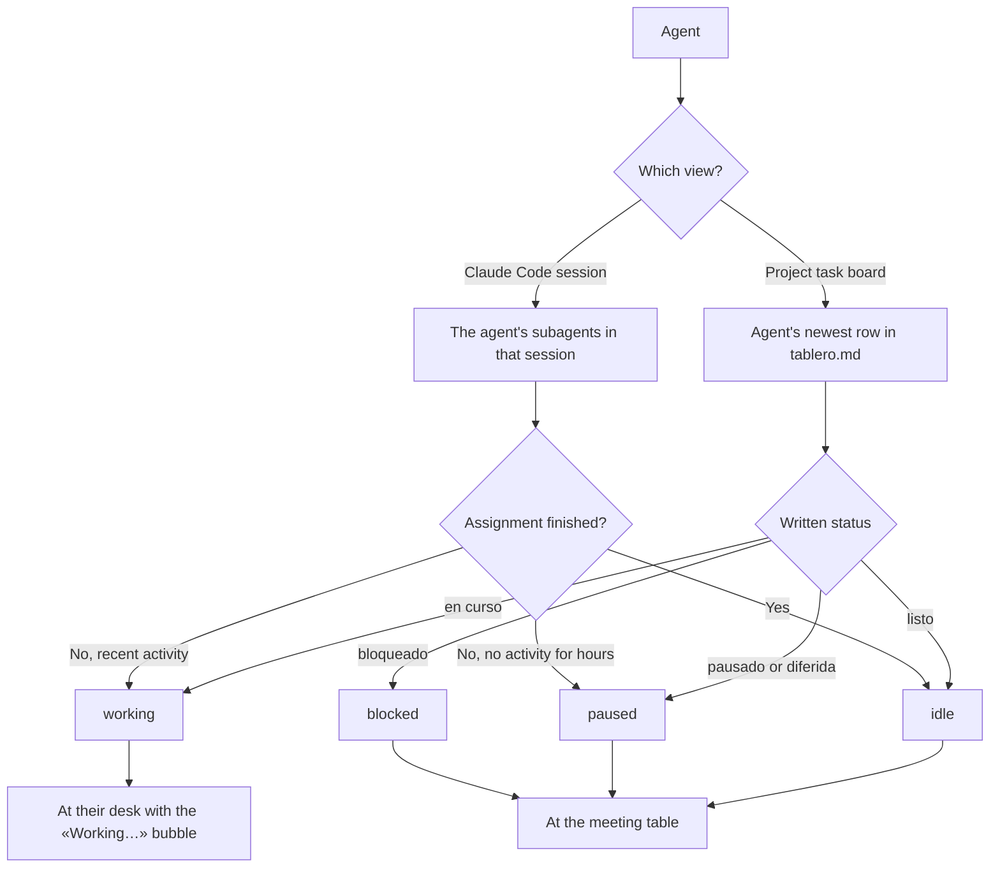

# Agents office

**English** · [Español](README.es.md) · [Deutsch](README.de.md)

An isometric pixel-art office in your browser that shows what your Claude Code
agents are doing while they build a project: who is working, which stage the
plan is at, who is waiting for your reply and how much of your usage limits is
left. Available in Spanish, English and German. Plain Python with no
dependencies; it runs on your computer and publishes nothing.

## What it shows

- **The room:** one desk per agent. Whoever is working sits at their desk, with
  the screen on and a «Working…» bubble. The others sit at the meeting table;
  when their status changes, they walk from one place to the other.
- **The walls:** the 8 process phases (Analysis, Design, Implementation,
  Testing, Security, Review, Documentation, Delivery), with the current phase
  highlighted, and the **change plan** by stages. Click the plan to open it in
  full.
- **Waiting for your reply:** a bubble that bounces over the table when the
  coordinator has stopped and needs you to answer.
- **Sessions:** a menu to switch between your active Claude Code sessions. Each
  session shows its own agents, plan and phases.
- **Usage limits:** the 5-hour window and the weekly limit, with the time each
  one resets.
- **Agent card:** click an agent to see their status, task, time, tokens and
  history.
- **Languages:** ES / EN / DE switch in the top bar; your choice is remembered.
- Light and dark mode, and a phone layout.

## How it works

`office.py` reads the project log (task board and the module's plan file), the
metadata of your Claude Code sessions and your usage limits, and builds one
self-contained HTML page per language. In live mode it serves the page on
`localhost` and updates it without reloading whenever something changes.

### Data model



### Sequence (live mode)



### Flow: status of an agent



## User guide

### Requirements

- Python 3.10 or newer.
- For sessions and usage limits: Claude Code installed (the `claude` command
  works in a terminal) and signed in. Without it the office still works, just
  without those two parts.

### Try it

From the repo folder:

```bash
python3 office.py --watch 10
```

A browser window opens at `http://localhost:8765`. If there is no project log
next to it, it uses the data in `example/`. Press **Ctrl+C** to stop it.

- `--watch 10`: live mode. Checks for changes every 10 seconds and updates the
  page without reloading it (room, panel and usage meters). If the code, the
  configuration or a language file changes, the server restarts by itself and
  the open window reloads by itself.
- Without `--watch`: writes `office.html` (default language), `office.en.html`
  and `office.de.html`, and opens the first one.

The server only listens on your computer (`127.0.0.1`). If the port is busy,
use `--port 8766`.

### Use it with your project

The office reads two Markdown files, which the coordinator agent usually fills
in while it works:

```text
bitacora/
├── tablero.md
├── planes/
│   └── <module>.md
└── oficina/          ← this repo
```

If you put the repo inside the log folder as shown, it finds them by itself.
Otherwise, tell it where they are:

```bash
python3 office.py --watch 10 --board path/tablero.md --plans path/planes --module my_module
```

#### The task board (`tablero.md`)

A table with one row per task. The log format is in Spanish, so the column
names and statuses are Spanish:

```markdown
| Tarea | Etapa | Agente | Estado | Actualizado | Nota |
|---|---|---|---|---|---|
| my_module: Etapa 2 (monthly report) | Implementación | Yunho Developer | en curso | 2026-11-17 09:30 |  |
| my_module | Seguridad | Seonghwa Auditor | bloqueado | 2026-11-16 17:00 | no test database yet |
```

- **Tarea** (task): starts with the module name (`my_module` or
  `my_module: …`). If it says «Etapa N», it counts for stage N of the plan.
- **Agente** (agent): it is enough that it contains the agent's name.
- **Estado** (status): `en curso` = working, `bloqueado` = blocked,
  `pausado` or `diferida` = on hold, `listo` = no task.
- **Actualizado** (updated): for each agent, its newest row counts.
- **Etapa** (stage): marks which process phase the module is in.
- **Nota** (note): shown in the agent card.

Every word the office looks for in the log lives in `office/board.py`.

#### The plan file (`planes/<module>.md`)

Three sections, all optional:

- `## Dónde quedé` (where we left off): entries
  `**YYYY-MM-DD (Agent) — what was done**`, added to each agent's history.
- `## Avance por fase` (progress by phase): table
  `| Fase | Estado | Fecha | Agente |` for the phases on the wall.
- `## Plan por etapas` (staged plan): one line
  `Etapas: 1 description; 2 description; …`, which is the plan shown on the
  wall.

There is a complete example in `example/`.

### Languages

The interface texts live in `i18n/es.json`, `i18n/en.json` and `i18n/de.json`,
with the same keys. The default language and the list of languages are set in
`config.json` (`language`, `languages`). To add one, copy a file, translate it
and add it to `languages`. Keep the placeholders in braces, such as `{n}` or
`{title}`: that is where the data goes. Project data (tasks, notes, session
titles) is not translated.

### Customise

- **`config.json`:** default module, coordinator, agents (key, name, role and
  zone), phases and how to recognise them in the log, position of desks, table
  and rugs in the room, and thresholds (minutes for a session to count as
  active, amber and red percentages for the limits, how often they are
  checked…).
- **Avatars:** put `avatars/<key>.png` (each agent's `key`). If one is missing,
  a pixel-art character drawn by the script is used. The `avatars/` folder is
  in `.gitignore` so your images are not uploaded.

### Options

| Option | Purpose |
|---|---|
| `--watch SECONDS` | Live mode: local server, checking for changes every so many seconds. |
| `--port N` | Server port (default 8765). |
| `--module NAME` | Module to show. |
| `--board PATH` / `--plans PATH` | Where the task board and the plan files are. |
| `--sessions PATH` | Claude Code sessions folder; `""` to skip sessions. |
| `--avatars PATH` | Avatars folder; `""` to use only the drawn characters. |
| `--tokens name=N` | Tokens written by hand for an agent (repeatable). |
| `--no-usage` | Do not check the usage limits. |
| `--no-open` | Do not open a browser window. |
| `--output PATH` | Where to write the generated page. |

## Code structure

```text
office.py                entry point (command-line options)
office/
├── config.py            configuration, paths and program version
├── models.py            data structures (dataclasses)
├── board.py             reads the task board and plan files (log format)
├── state.py             what the office shows, and live session work
├── sessions.py          Claude Code sessions: metadata only
├── usage.py             usage limits through /usage
├── i18n.py              translated texts
├── build.py             reads everything and writes one page per language
├── server.py            live mode
├── render/
│   ├── geometry.py      isometric projection and shapes
│   ├── pixel.py         pixel art: characters and decorations
│   ├── room.py          the room: walls, desks, table
│   ├── panel.py         side panel, menu, modals, usage meters
│   ├── labels.py        dates, numbers and statuses per language
│   └── page.py          assembles the whole page
└── static/
    ├── office.css
    └── office.js
i18n/es.json, en.json, de.json
config.json
example/                 example task board and plan file
```

**Naming:** code in English. Python follows PEP 8 (`snake_case` for functions
and variables, `UPPER_CASE` for constants, `CapWords` for classes) with type
hints; JSON keys in `snake_case`; CSS classes in `kebab-case`; JavaScript in
`camelCase`. Style is checked with `black` and `ruff` (configured in
`pyproject.toml`).

## Privacy

- Only metadata is read from Claude Code sessions: title, times, each
  subagent's assignment, whether it finished, which tool it used and the
  tokens. Never the text of the conversations.
- Usage limits are checked with Claude Code's `/usage` command, which uses no
  tokens and saves no session. The result is stored in `usage.json`, which is
  not uploaded to the repo.
- The generated pages (`office*.html`) contain your project data: they are not
  uploaded either.

## License

MIT. See `LICENSE`.
